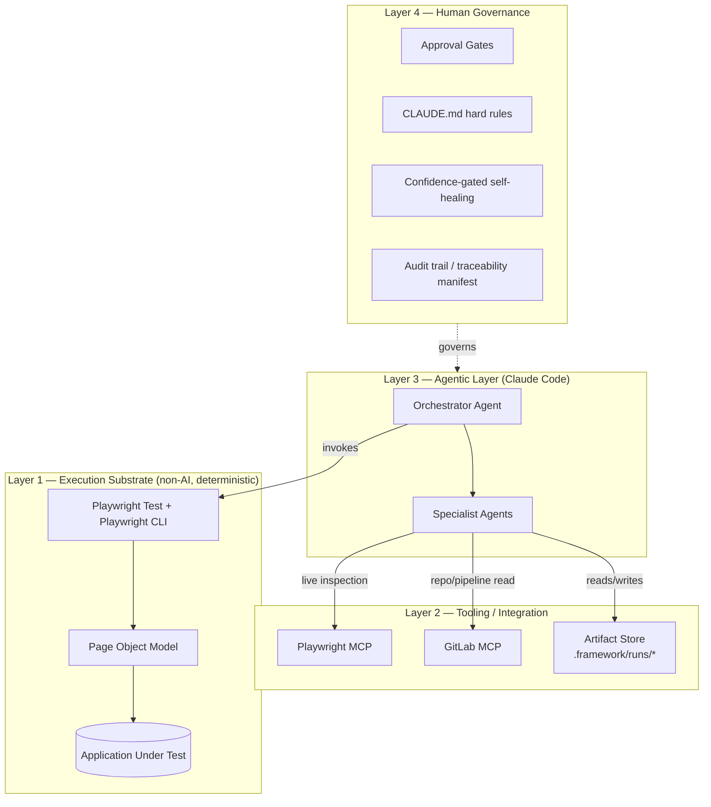
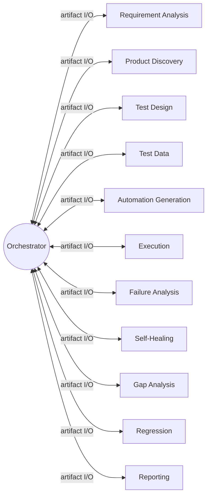
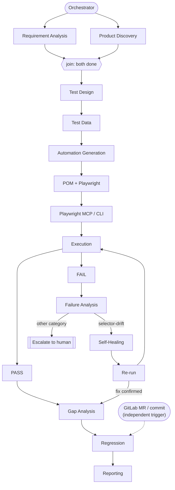
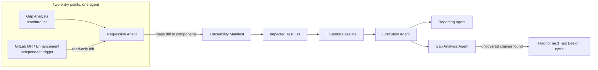
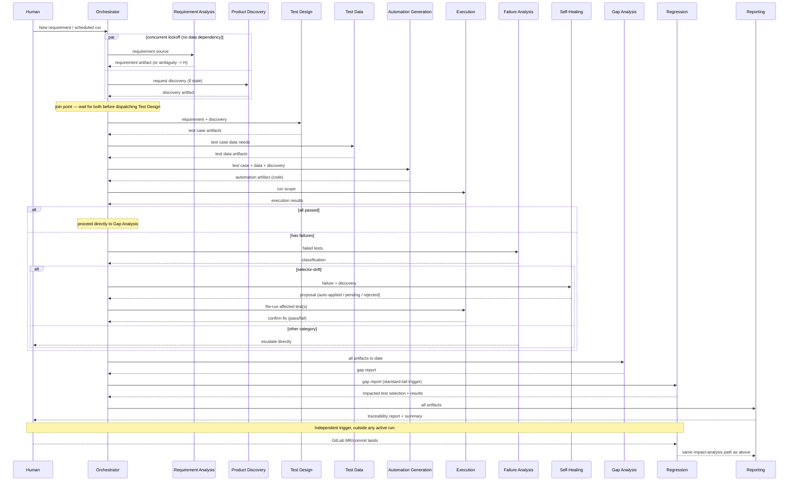
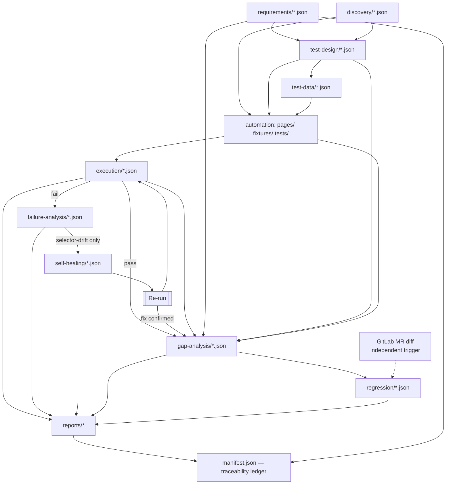

# AI Agentic Web Automation Testing Framework — Architecture Proposal

Status: **FINALIZED 2026-08-25 — all 7 Section 9 decisions explicitly reviewed and approved.**
The full framework has since been **implemented in DRY-RUN/SYNTHETIC mode** (see
"Implementation Status" below and `FINAL_FRAMEWORK_STATUS.md`). Sections describing later
phases that require real GitLab write access or CI expansion beyond the Execution Agent remain
unimplemented until their own phase gate and explicit approval are reached — those are gated by
policy, not by missing code.
Scope: This document remains the design source of truth. No real application page objects, no
GitLab write access, and no real application URL/credentials exist anywhere in this project.

---

## 0. Design Principles

1. **Deterministic execution stays deterministic.** Playwright/Playwright CLI runs tests. AI
   agents author, diagnose, and report — they do not become part of the runtime path that
   decides pass/fail.
2. **Every agent is single-responsibility and stateless.** No agent holds memory between runs;
   everything an agent needs comes in as an artifact, everything it produces goes out as an
   artifact.
3. **No agent talks to another agent directly.** All handoffs go through the Orchestrator and a
   versioned artifact store on disk. This makes every handoff inspectable (open a file) and
   matches how Claude Code sub-agents actually work (no shared memory between invocations).
4. **Assertions are sacred.** No agent — regardless of confidence — may ever change what a test
   asserts. This is enforced structurally (file/line scoping), not just by instruction.
5. **Every irreversible or externally-visible action is gated.** Writing to GitLab, merging a
   self-healing fix, deleting a test — all require an explicit human approval point.
6. **Read-only by default.** Every new capability (GitLab write access, auto-apply self-healing,
   CI-triggered generation) ships disabled and is turned on as a deliberate, separate decision.

---

## 1. Overall System Architecture

Four layers, strictly ordered so that AI involvement never sits underneath the thing that
decides whether a test passed:



- **Layer 1** is what exists today (Playwright, POM, smoke test) and remains untouched by this
  proposal until an approved implementation phase.
- **Layer 2** is the current `.mcp.json` (Playwright MCP connected, GitLab MCP installed,
  read-only) plus a new **artifact store** — a plain directory tree, not a database — that is
  the single source of truth for agent handoffs.
- **Layer 3** is new: an Orchestrator plus 11 specialist agents, each defined as a Claude Code
  **Skill** with a narrow tool allowlist.
- **Layer 4** is policy, not code: the rules every agent operates under, enforced by scoping
  (what files/tools an agent's Skill is allowed to touch) and by explicit pause points.

---

## 2. Agentic Architecture

**Pattern: Orchestrator + Specialist Agents (hub-and-spoke), file-based data contracts.**

- The **Orchestrator** is the only agent that sequences work. Specialist agents never invoke
  each other.
- Each specialist agent is a **Claude Code Skill** (`SKILL.md`) with:
  - a declared **input artifact type** it consumes,
  - a declared **output artifact type** it produces,
  - a **tool allowlist** (e.g. Test Design Agent gets Playwright MCP + filesystem, never GitLab
    write tools; Self-Healing Agent gets filesystem write access scoped to `pages/` only),
  - a **"not allowed to" list** enforced by scoping, not just instruction.
- Communication is **asynchronous and artifact-based**: an agent reads its input artifact(s)
  from `.framework/runs/<run-id>/...`, does its work, writes its output artifact, and updates
  its entry in the run's `manifest.json`. It never receives another agent's raw
  conversation/context.
- The Orchestrator reads `manifest.json` after each phase, decides whether a human approval
  gate applies (see Section Q), and either proceeds, pauses, or halts.
- This mirrors Claude Code's real primitives: Skills for behavior definition, the Agent/Task
  mechanism for invocation, and the filesystem for the only durable state between agent
  invocations — nothing here assumes a custom multi-agent runtime that doesn't exist.



**Canonical pipeline flow** (confirmed 2026-08-24): Requirement Analysis and Product Discovery
are dispatched **concurrently** by the Orchestrator — they don't depend on each other's output.
Test Design is a **join point**: it is only dispatched once both finish, and receives their
combined output. Everything from Test Data onward is sequential. Execution branches on
pass/fail; a self-healing fix always loops back through an explicit **Re-run** before Gap
Analysis. Regression sits in the standard tail of every run, but can *also* be triggered
independently when a GitLab MR/commit lands outside an active run (Section J).



---

## 3–14. Agent Specifications

### 3. Orchestrator Agent

- **Purpose:** Sequence the pipeline, enforce approval gates, own the traceability manifest.
- **Responsibilities:** Decide phase order; invoke each specialist with the correct input
  artifact path; read each output artifact's `status` field; pause for human approval at
  configured gates; never generate test logic, code, or data itself. Dispatches Requirement
  Analysis and Product Discovery **concurrently** (no data dependency between them) and holds
  Test Design at a join point until both complete. After a self-healing fix is applied, routes
  execution back through an explicit **Re-run** step before continuing to Gap Analysis — a
  fix is never considered successful without a confirming re-run. Also accepts an independent
  GitLab MR/commit event as a standalone trigger for the Regression Agent, outside the normal
  requirement-driven run (see Section J).
- **Inputs:** A run request (e.g. "new requirement", "new MR", "nightly regression"); the
  current `manifest.json`.
- **Outputs:** Updated `manifest.json`; a human-readable run summary at the end.
- **Tools:** Filesystem (artifact store), ability to invoke other Skills/agents. No direct
  Playwright, no direct GitLab write.
- **Skills required:** Orchestration/state-machine logic, approval-gate policy from Section Q.
- **Communicates with:** All 11 specialist agents (never lets them talk to each other).
- **NOT allowed to:** Write test code, modify assertions, write to GitLab, skip a configured
  approval gate, mark a run "complete" when any phase has `status: failed`.
- **Human approval required for:** Starting a run against anything other than the currently
  approved target scope; any gate listed in Section Q.

### 4. Requirement Analysis Agent

- **Purpose:** Turn a requirement source (ticket, spec doc, acceptance criteria) into a
  structured, testable requirement artifact.
- **Responsibilities:** Extract discrete, atomic requirements; assign a stable requirement ID;
  flag ambiguous/untestable requirements instead of guessing; preserve a link back to the
  source (issue URL, doc section).
- **Inputs:** Raw requirement text, or a GitLab issue reference (read-only, via GitLab MCP).
- **Outputs:** `requirements/<req-id>.json` — `{ id, title, description, acceptanceCriteria[],
  sourceRef, ambiguities[], status }`.
- **Tools:** GitLab MCP (read-only: issues/MRs/wiki), filesystem.
- **Skills required:** Requirements decomposition, acceptance-criteria writing, ambiguity
  detection.
- **Communicates with:** Orchestrator only (output consumed downstream by Test Design and Gap
  Analysis via the manifest).
- **NOT allowed to:** Invent acceptance criteria not implied by the source; write to GitLab;
  mark an ambiguous requirement as resolved on its own judgment.
- **Human approval required for:** Any requirement flagged `ambiguities: [...]` must be
  clarified by a human before Test Design consumes it.

### 5. Product Discovery Agent

- **Purpose:** Build and maintain a live map of the application's pages/components/flows, so
  downstream agents design against reality, not assumption.
- **Responsibilities:** Use Playwright MCP to navigate the target app; capture accessibility
  tree, key locators, and screenshots per page/flow; detect and record navigation structure;
  flag pages that changed since the last discovery pass.
- **Inputs:** Target base URL(s) (only once approved — see restrictions below), prior
  discovery snapshot (if any).
- **Outputs:** `discovery/<page-id>.json` — `{ url, role, accessibilityTree, keyLocators[],
  screenshotRef, lastSeen, diffFromPrevious }`.
- **Tools:** Playwright MCP (live browser), filesystem. Read-only against the application —
  no form submissions beyond what's needed to reach a page (e.g. login via the Authentication
  Architecture in Section B, never ad-hoc data entry).
- **Skills required:** Accessibility-tree reading, visual/DOM diffing, navigation mapping.
- **Communicates with:** Orchestrator only; output consumed by Test Design, Automation
  Generation, and Self-Healing.
- **NOT allowed to:** Perform destructive or state-changing actions on the app beyond
  authenticated navigation; infer business logic not observable in the UI.
- **Human approval required for:** First run against any new target URL (this agent is
  inert until the application URL is explicitly provided and approved — out of scope for this
  document per your instructions).

### 6. Test Design Agent

- **Purpose:** Convert approved requirements + discovery data into structured test case
  specifications (not code yet).
- **Responsibilities:** Derive positive, negative, and edge-case test cases per acceptance
  criterion; assign each test case a stable ID linked to its requirement ID; specify required
  test data shape (not values) and required page objects (not implementations).
- **Inputs:** `requirements/<req-id>.json`, `discovery/<page-id>.json`.
- **Outputs:** `test-design/<tc-id>.json` — `{ id, requirementId, title, steps[],
  expectedResult, dataNeeds, pageObjectsNeeded[], priority, type: positive|negative|edge }`.
- **Tools:** Filesystem. Read access to discovery artifacts. No Playwright MCP live session
  (uses the snapshot, doesn't need a live browser).
- **Skills required:** Test-case design, equivalence partitioning/boundary analysis, Gherkin or
  structured-step authoring.
- **Communicates with:** Orchestrator only; output consumed by Test Data, Automation
  Generation, and Gap Analysis.
- **NOT allowed to:** Design a test case for a requirement that doesn't exist; write
  executable code; decide test data values.
- **Human approval required for:** Test case sets touching a high-risk category before
  automation begins. Initial list (finalized 2026-08-25, Decision 6; extend as the real
  application's scope becomes known): Payments; PII / Sensitive Data; User Account Deletion;
  Financial Transactions; Authentication / Authorization.

### 7. Test Data Agent

- **Purpose:** Produce the data each test case needs, dynamically, without collisions.
- **Responsibilities:** Generate synthetic data (unique per run via timestamp/UUID suffixing);
  define API-based setup/teardown calls where UI-based setup would be slow or flaky; document
  cleanup steps per data item so environments stay idempotent.
- **Inputs:** `test-design/<tc-id>.json` (`dataNeeds`).
- **Outputs:** `test-data/<tc-id>.json` — `{ testCaseId, dataSetId, generationMethod:
  synthetic|api|reference, payload, setup[], teardown[] }`.
- **Tools:** Filesystem, application API client (read/write against a **test** environment
  only, never production), no Playwright MCP.
- **Skills required:** Data modeling, boundary/equivalence data generation, idempotent
  setup/teardown design.
- **Communicates with:** Orchestrator only; output consumed by Automation Generation and
  Execution.
- **NOT allowed to:** Generate or reference real user PII; target any environment other than
  the explicitly configured test environment; skip defining a teardown step for data it
  creates.
- **Human approval required for:** Any data generation strategy that requires a new API
  credential/scope.

### 8. Automation Generation Agent

- **Purpose:** Turn test case + test data specs into actual Playwright POM code.
- **Responsibilities:** Generate/extend page objects under `pages/` (locators sourced from
  Product Discovery snapshots, never invented); generate fixtures under `fixtures/`; generate
  spec files under `tests/` that import from fixtures, per the existing `SKILL.md` convention
  (already established — see Section D).
- **Inputs:** `test-design/<tc-id>.json`, `test-data/<tc-id>.json`, `discovery/<page-id>.json`.
- **Outputs:** New/updated files in `pages/`, `fixtures/`, `tests/`, plus
  `automation/<tc-id>.json` — `{ testCaseId, specFile, pageObjectsTouched[], status }`.
- **Tools:** Filesystem (write access to `pages/`, `fixtures/`, `tests/` only — no config, no
  CI files, no `.mcp.json`), Playwright MCP (to validate a generated locator resolves before
  committing to it).
- **Skills required:** Playwright API fluency, POM conventions from this project's `SKILL.md`,
  role-based-locator-first selector strategy.
- **Communicates with:** Orchestrator only; output consumed by Execution and Regression.
- **NOT allowed to:** Modify `playwright.config.js`, `.mcp.json`, or CI files; hardcode secrets
  or credentials; write an assertion whose expected value wasn't specified by Test Design.
- **Human approval required for:** First-time creation of a new page object file (subsequent
  edits to an already-approved page object can proceed without re-approval, per the
  Self-Healing rules in Section H if applicable); any generated spec before it's merged.

### 9. Execution Agent

- **Purpose:** Run the deterministic Playwright suite and capture machine-readable results.
- **Responsibilities:** Invoke `npx playwright test` (existing scripts) with the correct
  tag/project scope (smoke, targeted, full regression); collect both the existing HTML
  reporter output and a JSON reporter output for downstream machine consumption; never modify
  test files.
- **Inputs:** A run scope (which spec files/tags/projects); `.auth/*.json` storage state per
  Section B.
- **Outputs:** `execution/<run-id>.json` (Playwright JSON reporter, normalized), plus the
  existing `playwright-report/` HTML artifact.
- **Tools:** Playwright CLI only. No MCP, no filesystem writes outside `test-results/` and
  `playwright-report/`.
- **Skills required:** Playwright CLI flag fluency (project/grep/shard selection), CI-aware
  execution (retries, workers).
- **Communicates with:** Orchestrator only; output consumed by Failure Analysis, Reporting,
  Regression.
- **NOT allowed to:** Edit any test, page object, or fixture; retry a failing test in a way
  that hides a real failure (retries are configured once in `playwright.config.js`, not
  decided ad hoc by this agent).
- **Human approval required for:** None — this agent only executes pre-approved code; it is
  the one specialist agent safe to run unattended/in CI from day one.

### 10. Failure Analysis Agent

- **Purpose:** Triage every failed test into a root-cause category before anyone (human or
  Self-Healing Agent) attempts a fix.
- **Responsibilities:** Classify each failure as one of: **selector drift** (element
  moved/renamed), **timing/flake** (race condition, no DOM change), **environment** (app/API
  down, network), **real regression** (assertion correctly caught a behavior change), or
  **test bug** (test itself is wrong); attach evidence (trace, screenshot, DOM diff via
  Playwright MCP) to its classification.
- **Inputs:** `execution/<run-id>.json`, Playwright trace files, `discovery/<page-id>.json`.
- **Outputs:** `failure-analysis/<run-id>/<test-id>.json` — `{ testId, category, confidence,
  evidence[], suspectedRootCause, recommendedNextAgent: self-healing|human|none }`.
- **Tools:** Playwright MCP (compare live DOM vs. expected), filesystem (read-only on
  traces/execution results).
- **Skills required:** Trace/DOM diffing, flake pattern recognition, root-cause taxonomy.
- **Communicates with:** Orchestrator only; routes to Self-Healing (selector drift only) or
  directly to a human (everything else).
- **NOT allowed to:** Modify any file; reclassify a "real regression" as anything else to
  avoid escalation; auto-forward to Self-Healing anything other than `category:
  selector-drift`.
- **Human approval required for:** Every category except `selector-drift` is a hard stop to a
  human — Failure Analysis never lets timing/environment/regression/test-bug failures reach
  Self-Healing.

### 11. Self-Healing Agent

- **Purpose:** Propose (and, only at high confidence, locally apply) narrow, low-risk fixes for
  selector-drift failures — and nothing else. Never touches assertions, expected outcomes, or
  test intent, at any confidence level. See Section H for the full decision model and
  safeguards (finalized 2026-08-25, Decision 1).
- **Responsibilities:** Given a `category: selector-drift` failure, use Playwright MCP to find
  the element's current, stable locator; produce a minimal diff to the relevant `pages/*.js`
  file limited to locator-level or similarly low-risk structural changes; score its own
  confidence; apply/hold/reject per Section H's confidence model; for any change that reaches
  "apply," always execute the full sequence: diff → re-run the affected test → confirm
  assertions unchanged → write the audit record → open a GitLab MR → wait for human review
  before merge.
- **Inputs:** `failure-analysis/<run-id>/<test-id>.json` (must be `selector-drift`),
  `discovery/<page-id>.json`.
- **Outputs:** `self-healing/<run-id>/<test-id>.json` — `{ testId, proposedDiff,
  confidence: high|medium|low, filesTouched[], assertionTouched: boolean, rerunResult:
  pass|fail, decision: auto-applied-pending-merge-review|pending-approval|rejected }`.
- **Tools:** Playwright MCP (read-only inspection), filesystem write **scoped to `pages/`
  only** (structurally enforced — see Section H), Execution Agent invocation (to trigger the
  mandatory re-run).
- **Skills required:** Locator-stability analysis, minimal-diff generation, self-assessment/
  confidence scoring.
- **Communicates with:** Orchestrator only.
- **NOT allowed to:** Touch any file under `tests/` or `fixtures/`; touch any line matching an
  assertion pattern anywhere, or modify any expected business outcome/validation logic/test
  intent by any means; touch `playwright.config.js`, `.mcp.json`, or CI files; act on any
  failure not classified `selector-drift` by Failure Analysis; auto-apply anything below `high`
  confidence; apply a change broader than a locator-level or similarly low-risk structural fix,
  even at high confidence; merge its own opened MR.
- **Human approval required for:** All `medium` confidence proposals (blocking — no file
  changes until approved); all `low` confidence findings are report-only, no proposal is even
  generated for auto-apply. `High` confidence changes are auto-applied **locally** and
  re-run automatically, always logged, and — once GitLab MCP write access is a separately
  approved Phase 9 capability — opened as a GitLab MR (never pushed straight to a protected
  branch); **merging that MR always requires human review, with no exception for high
  confidence.**

### 12. Gap Analysis Agent

- **Purpose:** Find coverage holes — requirements with no test, test cases with no automation,
  automation that hasn't run recently, and app changes with no corresponding test.
- **Responsibilities:** Cross-reference `requirements/`, `test-design/`, `automation/`, and
  `execution/` artifacts; cross-reference GitLab MR diffs (read-only) against the automation
  inventory to find changed code paths with no test.
- **Inputs:** All requirement/test-design/automation/execution artifacts to date; GitLab MR
  diffs (read-only).
- **Outputs:** `gap-analysis/<run-id>.json` — `{ requirementsWithoutTests[],
  testCasesWithoutAutomation[], staleAutomation[], uncoveredCodeChanges[] }`.
- **Tools:** Filesystem (read-only), GitLab MCP (read-only).
- **Skills required:** Traceability-matrix reasoning, diff-to-feature mapping.
- **Communicates with:** Orchestrator only; output consumed by Reporting and (optionally) fed
  back to Requirement/Test Design Agents for the next cycle.
- **NOT allowed to:** Create test cases itself (it identifies gaps, Test Design fills them);
  write to GitLab.
- **Human approval required for:** None to run; a human decides which gaps get prioritized
  into the next Test Design cycle.

### 13. Regression Agent

- **Purpose:** Given a code change, determine the minimal-but-safe set of tests to re-run.
- **Responsibilities:** Pull an MR/commit diff (read-only, GitLab MCP); map changed
  files/components to page objects and test cases via the traceability manifest; select the
  impacted subset plus a fixed smoke-test baseline; request Execution Agent to run that
  selection.
- **Inputs:** Two trigger paths, same artifact contract either way: (a) the standard tail of
  every requirement-driven run, dispatched right after Gap Analysis completes; or (b) an
  independent GitLab MR/commit event (read-only) arriving outside any active run. Both read
  `manifest.json` (requirement→test→automation mapping) for impact mapping.
- **Outputs:** `regression/<run-id>.json` — `{ trigger, changedFiles[], impactedTestIds[],
  smokeBaselineIds[], selectedForExecution[] }`.
- **Tools:** GitLab MCP (read-only), filesystem.
- **Skills required:** Impact analysis / dependency mapping between code and tests.
- **Communicates with:** Orchestrator only; hands its selection to Execution.
- **NOT allowed to:** Narrow the smoke-test baseline to zero; write to GitLab; skip running
  impacted tests to save time.
- **Human approval required for:** None to run automatically on every MR (read-only); a human
  approves before this expands into any auto-comment-on-MR behavior (write scope).

### 14. Reporting Agent

- **Purpose:** Turn every other agent's output into human-consumable reporting and a live
  traceability matrix.
- **Responsibilities:** Aggregate execution results, self-healing actions, gap analysis, and
  regression outcomes; produce the traceability document (Section A); never re-interpret a
  result (e.g., never turn a failure into a "pass" in the summary).
- **Inputs:** All artifacts for the run.
- **Outputs:** `reports/<run-id>/summary.json`, `reports/<run-id>/traceability.md`, plus the
  existing Playwright `playwright-report/` HTML output passthrough.
- **Tools:** Filesystem (read all artifacts, write only under `reports/`). GitLab MCP
  (read-only) only if MR-comment publishing is separately approved.
- **Skills required:** Report synthesis, traceability-matrix formatting.
- **Communicates with:** Orchestrator only; terminal agent in the pipeline.
- **NOT allowed to:** Change or omit a failing result to make a run look healthier; write to
  GitLab without separate approval.
- **Human approval required for:** Publishing a report externally (e.g., as a GitLab MR
  comment) once that capability exists.

---

## A. Traceability Model (Requirement → Test Case → Automation → Execution → Report)

Single source of truth: `manifest.json` per run, a flat table keyed by requirement ID:

```json
{
  "REQ-1023": {
    "testCaseIds": ["TC-1023-01", "TC-1023-02"],
    "automation": { "TC-1023-01": "tests/login/valid-login.spec.js" },
    "lastExecution": { "TC-1023-01": { "runId": "run-42", "status": "passed" } },
    "reportRef": "reports/run-42/traceability.md#REQ-1023"
  }
}
```
Every agent writes into this table via its own artifact; the Orchestrator is the only writer of
`manifest.json` itself (it reads each phase's output and updates the table), keeping a single
append-only history so "why did this test exist" is always answerable.

## B. Authentication / Token Reuse Architecture

- Playwright's `storageState` pattern: a dedicated `auth.setup.js` project logs in once per
  role and saves session state to `.auth/<role>.json` (gitignored, treated as a secret).
- All other projects/tests declare `use: { storageState: '.auth/<role>.json' }` and never log
  in via the UI themselves — faster and removes login flow flakiness from unrelated tests.
- A freshness check (lightweight authenticated request) runs before a suite starts; expired
  state triggers a single re-login via `auth.setup.js`, not per-test.
- Multiple roles = multiple storage-state files + one Playwright `project` per role.
- Credentials themselves live only in environment variables / CI secret variables, never in
  any artifact, code, or agent-visible file.

## C. Dynamic Test-Data Architecture

- Test Data Agent owns this end-to-end (see Section 7). Every generated value is unique per
  run (UUID/timestamp-suffixed) to avoid collisions in shared test environments.
- Three sourcing strategies, chosen per test case: synthetic generation, API-based setup
  (preferred for speed over UI setup), and curated reference datasets for edge cases.
- Every data artifact declares its own teardown — no test is allowed to leave orphaned state.
- Data generation only ever targets a designated **test** environment; this is a hard
  boundary, not a per-run choice.

## D. Page Object Model Architecture

Builds directly on what already exists in this repo:
- `pages/BasePage.js` — shared navigation/wait helpers (already established).
- One class per page/major component, extending `BasePage` (already established via
  `HomePage.js`).
- New: **component objects** for repeated fragments (nav bars, modals, tables) composed into
  page objects rather than duplicated across them.
- Locators are class properties, sourced from Product Discovery snapshots, role/label-first
  (matches existing `SKILL.md` convention) — never raw CSS/XPath unless nothing stable exists.
- This is the **only** layer Self-Healing may write to.

## E. Playwright MCP Interaction Model

- Used for **live, interactive** work only: Product Discovery (mapping the app), Automation
  Generation (validating a locator resolves before writing it), Failure Analysis / Self-Healing
  (comparing live DOM to what a failing test expected).
- **Not** used to execute the actual test suite — that stays on the deterministic Playwright
  CLI path so CI results never depend on an interactive MCP session being available.

## F. Playwright CLI Execution Model

- Execution Agent's only interface: `npx playwright test [--project=] [--grep=] [--shard=]`,
  building on the existing `npm test` / `npm run test:headed` / `npm run report` scripts.
- JSON reporter added alongside the existing HTML reporter (`reporter: [['html'], ['json',
  { outputFile: 'test-results/results.json' }]]`) so Failure Analysis/Reporting have a
  machine-readable input without touching how humans already view results.
- Retries/workers/sharding tuned per environment via existing `playwright.config.js`
  conventions (CI vs. local), not decided ad hoc by any agent.

## G. GitLab MCP Integration Model

- **Current state (unchanged by this proposal):** installed, registered in `.mcp.json`,
  `GITLAB_PERMISSION_MODE=readonly`.
- **Read-only usage** (available once env vars are set, no further approval needed per
  existing config): Requirement Analysis (issue context), Regression/Gap Analysis (MR diffs,
  pipeline status).
- **Write usage** (Self-Healing MR creation, Gap Analysis issue filing, Reporting MR comments)
  is a **separate, explicitly approved** future capability — switching `GITLAB_PERMISSION_MODE`
  away from `readonly` is itself an approval-gated architecture decision (see Section 9).

## H. Self-Healing Decision Model (with explicit safeguards)

**Hard, structural safeguards (not just prompt instructions):**

1. Self-Healing may only write to files under `pages/`. Enforced by tool/file-scoping on the
   agent's Skill definition, not by asking it nicely.
2. Any proposed diff is run through a mechanical guard (AST/pattern check) before it's even
   considered for auto-apply: if the diff touches a line matching an assertion pattern
   (`expect(`, `.toBe`, `.toEqual`, `.toHaveText`, `.toHaveValue`, `.toHaveCount`, or any file
   under `tests/`), the change is **auto-rejected**, full stop, regardless of confidence score.
3. Self-Healing never receives failures classified as anything other than `selector-drift` by
   Failure Analysis (Section 10) — it structurally cannot see a failure caused by a real
   regression, so it cannot "fix" a test by loosening what it checks.
4. Every self-healing action (applied or proposed) is logged to
   `self-healing/<run-id>/<test-id>.json` with the full diff and evidence — nothing is silent.
5. **(Finalized 2026-08-25 — Decision 1)** Self-healing must never modify assertions, expected
   business outcomes, validation logic, or test intent merely to make a test pass — under no
   circumstance, at no confidence level. High-confidence auto-healing is scoped narrowly to
   **safe locator-level changes and similarly low-risk structural fixes** only; nothing broader
   is eligible for auto-apply regardless of how confident the agent is.
6. **(Finalized 2026-08-25 — Decision 1)** Every self-healing change that reaches "apply" —
   at any confidence level — must, in order:
   1. Produce a diff (never applied in-place without a reviewable artifact)
   2. Trigger a re-run of the affected test to confirm the fix actually works
   3. Preserve all assertions exactly as they were (enforced by safeguard #2 above)
   4. Generate an audit record (`self-healing/<run-id>/<test-id>.json`)
   5. Open a GitLab MR rather than push directly to a protected branch
   6. Require human review **before that MR is merged** — this applies even at High
      confidence; "auto-apply" only ever means the local diff + re-run happen automatically,
      merge approval never does

**Confidence model:**

| Confidence | Criteria (indicative, tunable) | Action |
|---|---|---|
| **High** | Single unambiguous replacement locator found; matches by stable attribute (role/label/testid), not text/position; no assertion lines touched (guard already passed); element's semantic identity confirmed via accessibility tree, not just DOM position; change is a locator-level or similarly low-risk structural fix only | **Auto-apply** to `pages/*.js` locally, immediately re-run the affected test to confirm the fix, then (once GitLab write access is approved in Phase 9) auto-open an MR for visibility — never a direct push to a protected branch. **Merging always requires human review**, regardless of confidence or CI status. |
| **Medium** | Locator changed in a way that's plausible but ambiguous (e.g. multiple candidate matches, structural change nearby, lower similarity score) | **Propose only.** Diff is written to the artifact and surfaced to a human; no file is changed until approved. |
| **Low** | No confident single candidate; DOM changed substantially; can't rule out a real UI/behavior change | **No diff generated at all.** Only a written analysis is produced, test stays red, human takes it from there. |

## I. Gap-Analysis Model

Four gap types, computed by cross-referencing artifacts (Section 12): requirements with zero
linked test cases; test cases with zero linked automation; automation not executed within a
configurable staleness window; MR diffs (read-only) touching files with no corresponding test
in the traceability manifest. Output feeds the next Test Design cycle — Gap Analysis identifies,
Test Design (with human prioritization) resolves.

## J. Enhancement → Impact Analysis → Regression Model

The Regression Agent has **two independent trigger paths** into the same logic (confirmed
2026-08-24):

1. **Standard tail** — the last step of every requirement-driven run, dispatched right after
   Gap Analysis, using that run's own artifacts for impact mapping.
2. **Independent MR trigger** — a GitLab MR/commit landing outside any active run kicks off
   Regression on its own, reusing the same agent and the same traceability manifest.



## K. Reporting Architecture

Three outputs per run, all derived, never hand-adjusted:
1. `reports/<run-id>/summary.json` — machine-readable rollup for dashboards/future tooling.
2. `reports/<run-id>/traceability.md` — human-readable Requirement → Test → Execution → Gap
   view.
3. The existing Playwright `playwright-report/` HTML output, unchanged, still the primary
   human debugging view for a given run.
Publishing any of this to GitLab (MR comment, pipeline artifact link) is a read-only-safe
action once GitLab MCP is connected; posting *into* GitLab is a write action gated per Section
G.

## L. Security / Secrets Architecture

- No secret ever appears in an artifact, code file, or agent-visible log. `.env` stays
  git-ignored (already true today).
- `.auth/*.json` storage-state files are treated as secrets: git-ignored, excluded from any
  report or screenshot upload, never attached to a failure-analysis artifact.
- GitLab PAT and application credentials live only in environment variables or a CI secret
  store — referenced by name in config, never by value in anything an LLM reads.
- GitLab MCP defaults to `readonly` (already true today); elevation to write scope is a
  distinct, explicit decision (Section 9), not a side effect of adding more agents.
- Test Data Agent is hard-restricted to a designated test environment — no production
  credentials are ever in scope for this framework.

## M. Error Handling Architecture

- Every artifact carries `status: ok | partial | failed` plus structured error detail. The
  Orchestrator halts and surfaces to a human on `failed`; `partial` is flagged for review, not
  silently carried forward.
- Infrastructure errors (MCP disconnect, environment down, network blip) get a bounded number
  of automatic retries at the Orchestrator level. Logic errors (assertion failed, code defect)
  are never retried — retrying a real failure until it passes is exactly the failure mode this
  framework is designed to prevent.
- Nothing is a silent no-op: if an agent can't complete its task, its output artifact says so
  explicitly.

## N. Agent-to-Agent Handoff / Data Contract

- Every artifact: `{ id, runId, phase, producedBy, schemaVersion, status, data, evidence[] }`.
- Stored at `.framework/runs/<run-id>/<phase>/<artifact-id>.json`.
- Agents read only their declared input artifact type(s) and the shared `manifest.json` —
  never another agent's full working context, never a raw LLM transcript.
- `schemaVersion` on every artifact so the contract can evolve without breaking older runs'
  history.

## O. File / Folder Architecture

Summarized here; full proposed tree is in `PROJECT_STRUCTURE.md`. New top-level additions:
`.framework/` (artifact store + manifests, git-ignored contents except schemas), `.auth/`
(git-ignored storage state), `.claude/skills/<agent>/SKILL.md` files, `utils/`. Existing
`pages/`, `fixtures/`, `tests/`, `playwright.config.js`, `.mcp.json`, `SKILL.md` are extended,
not restructured.

## P. CI/CD Architecture

- Pipeline stages: `install → lint → smoke → regression (scheduled/on-MR) → publish report`.
- **Only the Execution Agent's path runs in CI initially** (`npx playwright test`) — it's pure
  Playwright CLI, no AI involved, safe to run unattended from day one.
- Generative/diagnostic agents (Test Design, Automation Generation, Self-Healing, etc.) run in
  interactive Claude Code sessions only, until the team has enough trust/history to consider
  triggering any of them from CI — a separate future decision, not part of this proposal.
- Report artifacts (`playwright-report/`, `reports/<run-id>/`) published as CI job artifacts;
  publishing to a GitLab MR comment is write-scope and gated per Section G.

## Q. Human-in-the-Loop Approval Points (consolidated)

| # | Gate | Who/what triggers it |
|---|---|---|
| 1 | Any requirement flagged ambiguous | Requirement Analysis Agent |
| 2 | First discovery run against a new target URL | Product Discovery Agent |
| 3 | Test case sets touching a high-risk category (Payments, PII/Sensitive Data, User Account Deletion, Financial Transactions, Authentication/Authorization — finalized 2026-08-25) | Test Design Agent |
| 4 | New data-generation strategy needing a new credential/scope | Test Data Agent |
| 5 | First-time creation of a new page object file; any new spec before merge | Automation Generation Agent |
| 6 | Every self-healing proposal at Medium confidence (no file changes until approved) | Self-Healing Agent |
| 6a | Merging any self-healing MR — **including High confidence** (auto-apply only ever means local diff + re-run, never merge) | Self-Healing Agent |
| 7 | Any failure not classified `selector-drift` | Failure Analysis Agent (routes straight to human) |
| 8 | Switching `GITLAB_PERMISSION_MODE` away from `readonly` | Project-level, one-time |
| 9 | Enabling any generative agent to run unattended in CI | Project-level, one-time |
| 10 | Publishing any report/comment externally to GitLab | Reporting Agent |

---

## Self-Healing Safeguards — Explicit Statement

The Self-Healing Agent **cannot**, under any confidence level, for any reason — including being
asked to "make the test pass":
- modify an assertion, expected business outcome, validation logic, or test intent, in any
  file, ever;
- modify a line matching an assertion pattern specifically (`expect(`, `.toBe`, `.toEqual`,
  `.toHaveText`, `.toHaveValue`, `.toHaveCount`), in any file;
- write to any file outside `pages/` (High-confidence changes are additionally scoped to
  locator-level and similarly low-risk structural fixes only — not everything `pages/` could
  theoretically contain);
- act on a failure not pre-classified `selector-drift` by a separate agent it cannot override;
- auto-apply anything below `high` confidence (medium = human approval required before any file
  changes; low = no diff produced at all);
- merge its own fix — even at `high` confidence, merge always requires human review of the
  opened GitLab MR (Section H, Decision 1 finalization).

Every applied or proposed change also goes through the same six-step sequence regardless of
confidence: diff → re-run → assertions preserved → audit record → GitLab MR → human review
before merge.

These are enforced by file/tool scoping and a mechanical pre-apply guard, not by asking the
model not to do it.

---

## Final Deliverables

### 1. Architecture Diagram
See Section 1 (system layers), Section 2 (agent hub-and-spoke plus the canonical pipeline flow
diagram with confirmed concurrency/branching semantics).

### 2. Agent Interaction Flow



### 3. Data Flow



### 4. Folder Structure Proposal
See `PROJECT_STRUCTURE.md` for the complete annotated tree.

### 5. Required `SKILL.md` Structure

**Implemented 2026-08-25, with one corrected path.** This project keeps its root `SKILL.md` as
the **human/Claude-Code-session-facing** conventions doc, and adds one scoped `SKILL.md` per
specialist agent under **`.claude/skills/<agent-name>/SKILL.md`** — corrected from this
section's original `.skills/` proposal, because `.claude/skills/` is the actual Claude Code
skill-discovery convention (a plain `.skills/` directory at repo root is not). This is a path
correction only; it changes no control flow, no agent contract, and no safety rule from the
rest of this document. Each file follows this template:

```markdown
---
name: <agent-name>
description: <when Claude Code should invoke this skill>
metadata:
  role: specialist-agent
  inputArtifact: <type>
  outputArtifact: <type>
---

# <Agent Name>

## Purpose
## Inputs (artifact schema)
## Outputs (artifact schema)
## Allowed tools
## Explicitly NOT allowed
## Human approval triggers
## Failure/error behavior
```

Root `SKILL.md` gains a short new section pointing to `.claude/skills/` and explaining the
Orchestrator pattern, without duplicating each agent's detail.

### 6. Required Project-Level `CLAUDE.md` Rules

**Created during Phase 1 implementation.** The rules proposed here were carried into the actual
`CLAUDE.md`, which is now the authoritative copy — this section is kept as the original design
rationale, not duplicated maintenance. If the two ever disagree, `CLAUDE.md` is current:
- Never modify an `expect(...)` assertion or its expected value, under any circumstance,
  including when asked to "make the test pass."
- Self-healing changes are only ever valid inside `pages/`; a change proposed anywhere else is
  a bug in the tooling, not a valid fix.
- `.mcp.json`'s `GITLAB_PERMISSION_MODE` stays `readonly` unless a human has explicitly changed
  it in that file — never change it from within an agent action.
- Never commit `.auth/`, `.env`, or anything matching a secret pattern.
- Every new page object requires a corresponding fixture entry and at least one spec before a
  run is considered complete for that flow (matches existing `SKILL.md` convention).
- No agent runs unattended in CI except the Execution Agent (pure Playwright CLI) until a human
  has separately approved otherwise.

### 7. Recommended Implementation Phases

| Phase | Scope | Gate to exit |
|---|---|---|
| 0 (done) | Scaffold: package.json, Playwright, POM skeleton, `.mcp.json`, `SKILL.md`, git | Smoke test passes |
| 1 | Authentication architecture (Section B) + Dynamic test-data infra (Section C), against a **known test target** once approved | Storage-state reuse verified; data factory produces unique, cleaned-up data |
| 2 | Single-agent pilot: Test Design Agent only, producing test-case artifacts (no code) for one real feature | Human review of generated test cases |
| 3 | Automation Generation + Execution Agents wired to Layer 1; JSON reporter added | Generated tests pass, traceability manifest populated |
| 4 | Failure Analysis Agent (classification only, no healing yet) | Correctly categorizes injected failures in a controlled test |
| 5 | Self-Healing Agent, **medium/low confidence only** (no auto-apply yet) | Guard-rail tests prove assertion-touching diffs are always rejected |
| 6 | Enable **high-confidence auto-apply**, still local-only (no GitLab write) | Track record from Phase 5 reviewed and approved |
| 7 | Gap Analysis + Regression Agents (read-only GitLab) | Correctly flags seeded gaps/impacted tests in a controlled scenario |
| 8 | Reporting Agent + full traceability document | Report matches manual audit of a run |
| 9 | GitLab MCP write-scope evaluation (MRs for self-healing, gap tickets) | Explicit, separate approval — not bundled with any other phase |
| 10 | CI integration beyond Execution Agent (if ever) | Explicit, separate approval |

### 8. Risks and Mitigation

| Risk | Mitigation |
|---|---|
| Self-healing silently weakens test quality | Structural assertion-touch guard (Section H) + confidence gating + full audit log |
| Agents drift into scope not granted (e.g. Test Design writing code) | Tool/file allowlists per Skill, not just written instructions |
| Flaky tests misclassified as selector-drift, triggering bad "fixes" | Failure Analysis Agent must show DOM-diff evidence; flake pattern is a separate category, never auto-routed to Self-Healing |
| GitLab write access granted too early, exposing accidental MR/issue spam | Kept `readonly` until an explicit, separately tracked approval (Phase 9) |
| Dynamic test data collides across parallel runs | UUID/timestamp-suffixed uniqueness + mandatory teardown per data artifact |
| Traceability manifest becomes stale/wrong | Single writer (Orchestrator only) for `manifest.json`, append-only history |
| Secrets leaking into agent context or reports | `.auth/`, `.env` git-ignored and excluded from all artifacts/reports by rule (Section L) |
| Framework scope creep before basics are proven | Phased rollout (Section 7) — no phase skips ahead of the previous one's exit gate |

### 9. Architecture Decisions — FINALIZED 2026-08-25

All seven explicitly reviewed and approved. This is the authoritative, final record —
supersedes the earlier 2026-08-24 provisional pass.

1. **Self-healing auto-apply policy** — ✅ **Approved (Option A)**, with an additional,
   explicit constraint layered on top:

   > Self-healing must **never** modify assertions, expected business outcomes, validation
   > logic, or test intent merely to make a test pass. High-confidence automatic healing is
   > initially limited to **safe locator-level changes and similarly low-risk structural
   > fixes** — nothing broader.

   Every self-healing change, at any confidence level that reaches "apply," must:
   1. Produce a diff (never applied blind/in-place without a reviewable record)
   2. Trigger a re-run of the affected test to confirm the fix actually works
   3. Preserve all assertions exactly as they were (structurally enforced — Section H)
   4. Generate an audit record (`self-healing/<run-id>/<test-id>.json`)
   5. Open a GitLab MR rather than push directly to a protected branch
   6. Require human review before that MR is merged — **including at high confidence**;
      "auto-apply" means the local diff + re-run happen automatically, merge never does

   This tightens Section H and the Self-Healing Agent spec (Section 11) below — see those
   sections for the updated language.
2. **GitLab write-scope timing** — ✅ **Approved (Option A)**: stays deferred to Phase 9.
   `.mcp.json` remains `GITLAB_PERMISSION_MODE=readonly` until then.
3. **Agent-to-Skill mapping** — ✅ **Approved (Option A)**: one `SKILL.md` per specialist agent,
   per Section 5 of the Final Deliverables. Implemented at `.claude/skills/<agent>/SKILL.md`
   (path corrected from this section's original `.skills/` proposal — see Section 5).
4. **CI scope** — ✅ **Approved (Option A)**: only the Execution Agent runs in CI initially
   (Phase 3+); all other agents stay interactive-session-only until Phase 10.
5. **Test environment definition** — ✅ **Approved (Option A)** as policy: a dedicated,
   non-production test environment is assumed for Test Data Agent and Product Discovery.
   **Still a Phase 1 blocker as data** — the policy is confirmed, but Phase 1 cannot start
   until the actual target application URL and environment details are provided.
6. **Compliance/high-risk area list** — ✅ **Approved (Option B)**. Initial high-risk
   categories, effective immediately for Section Q gate #3 (mandatory human review of test
   case sets in these areas before automation begins):
   - Payments
   - PII / Sensitive Data
   - User Account Deletion
   - Financial Transactions
   - Authentication / Authorization

   This list is a starting point, not exhaustive — extend it as the real application's scope
   becomes known (Phase 2 onward).
7. **Staleness window** — ✅ **Approved (Option B)**: **14 days** for Gap Analysis's
   "automation not executed recently" check. Configurable later without a doc change (a config
   value, not a hardcoded constant, once Gap Analysis is built in Phase 7).

---

## Implementation Status (updated 2026-08-25)

The full framework — all 12 agents, all schemas, the artifact store, CI foundation, and the
POM/auth/test-data foundations — has since been implemented and runs end-to-end in **DRY-RUN /
SYNTHETIC mode** (`npm run framework:dry-run`), validated by 80 framework tests plus the
preserved smoke test. See `README.md` for current status and `FRAMEWORK_READINESS_REPORT.md` /
`FINAL_FRAMEWORK_STATUS.md` for the full audit.

**What remains blocked is real-application work specifically**, not any open architecture
decision or missing framework code. Before any real, non-synthetic requirement/test-design/
automation work can begin, this still needs, at minimum:
- The test-environment application base URL(s)
- Which user roles/personas need separate authenticated sessions (drives how many
  `.auth/<role>.json` storage-state files and Playwright `projects` are needed)
- Confirmation of how credentials for those roles will be supplied (env var names only — no
  values shared in this document or chat, per Section L)

---

*This document is the design source of truth. Code, schemas, agents, POM foundations, and CI
configuration matching this design have been implemented — see the files themselves and the
framework readiness audit for what exists versus what is still proposed.*
